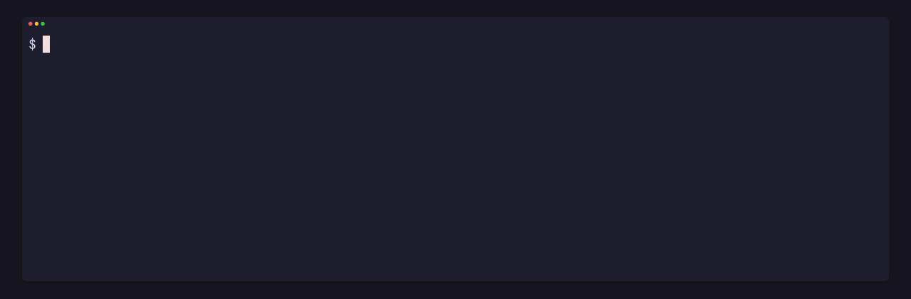

<p align="center"></p>

# pgpu

[](https://github.com/gmrdad82/pgpu/actions/workflows/ci.yml) [](https://github.com/gmrdad82/pgpu/tags)

pgpu shares one GPU between jobs and agents on a Linux machine with an AMD GPU, part of [PITO](https://pitomd.com). You put `pgpu run --` in front of a GPU command, and it waits for a lane, runs, and hands the card on when it's done. Renders, tests, benchmarks and searches from several sessions take turns instead of fighting over the card, and the card stays busy.

## What it is

- **Lanes.** `GPU_SLOTS` jobs run at once, never more. A free lane goes to the first job in line, and a waiter that doesn't take its lane within 3 s is passed over, so whatever waits fills the lanes. A running job never loses its lane.
- **Classes and turns.** Interactive jobs go first, then tests, clips, renders and benches, then ground-truth renders, then searches. A job that renders in passes calls `pgpu turn` between them, so a waiting job gets in. Sessions in the same class take turns.
- **Budgets.** Every class has a run-time budget. A job past it shows red in `pgpu status`, and pgpu stops a job at twice its budget, or after 5 minutes with no GPU work, turn or CPU. Time spent waiting or frozen never counts.
- **Memory ceilings.** Every job runs in its own cgroup with a memory ceiling, 24G unless `--memory` says otherwise, so one job can't take the machine down.
- **Re-runs alone.** A number that looks skewed can be re-run alone with `--alone "<why>"`. It waits for an empty queue, or at night (01:00 to 07:00) for the running jobs to end, and never freezes a job or jumps the line.
- **For scripts and agents.** `pgpu status --json` and `pgpu stats --json` are a stable contract ([docs/json.md](docs/json.md)), and each exit code means one thing.

pgpu is made for Linux with an AMD GPU on the amdgpu driver, and that is all it supports. It reads the card's busy percent and VRAM from amdgpu's sysfs files and each job's GPU use from DRM fdinfo, and it relies on cgroup v2 and `/proc`.

## Install

Each [release](https://github.com/gmrdad82/pgpu/releases/latest) carries a Linux x86_64 binary with a `SHA256SUMS` file.

```
v=$(basename "$(curl -fsSLo /dev/null -w '%{url_effective}' https://github.com/gmrdad82/pgpu/releases/latest)")
mkdir -p ~/.local/bin && curl -fsSL "https://github.com/gmrdad82/pgpu/releases/download/$v/pgpu-$v-linux-x86_64.tar.gz" | tar -xz -C ~/.local/bin pgpu
```

`~/.local/bin` needs to be on your `PATH`. **From source**, with Rust 1.97 or newer:

```
cargo install --locked --git https://github.com/gmrdad82/pgpu --tag vX.Y.Z pgpu
```

Replace `vX.Y.Z` with a [tag](https://github.com/gmrdad82/pgpu/tags).

### What it needs to run

- Linux with cgroup v2 and a systemd user session, so each job gets its own cgroup for its memory ceiling and for freezing. Where pgpu can't make one, it pauses a job with SIGSTOP instead, runs it without a ceiling, and says so.
- An AMD GPU on the amdgpu driver.

## Use

```
pgpu run [--class CLASS] [--as NAME] [--budget DURATION] [--memory SIZE] [--alone REASON] -- COMMAND [ARGS...]
pgpu turn [--work-ms MS] [--longest-ms MS]
pgpu status [--json]
pgpu stats [--days N] [--pace] [--json]
pgpu pause
pgpu resume
```

Run a job:

```
pgpu run --class render --as my-render -- blender -b scene.blend -a
```

- `--class` is one of `interactive` (5 min budget), `test` (10 min), `clip` or `render` (25 min), `bench` (20 min), `truth` or `search` (1 h). Without it, pgpu takes `PGPU_CLASS`, else `interactive`. An interactive job that runs over 60 s, or never calls `turn` in its first 5 s, takes turns as a clip, and so does a truth or search job whose waits add up to 10 minutes.
- `--as` names the session, so its jobs take turns with other sessions'. Without it, pgpu takes the nearest folder holding `.git`.
- `--budget` sets another run-time budget (`90s`, `15m`, `1h30m`), and `--memory` another ceiling (`32G`, `48G`).
- `--alone "<why the number looks skewed>"` re-runs a job alone. Without a reason it is refused.

The job sees `GPU_QUEUE=1`, `GPU_QUEUE_TURN`, `GPU_QUEUE_PID` and `GPU_QUEUE_FROZEN` (a file holding the milliseconds it has spent frozen or waiting, so it can correct its own timings). A `pgpu run` inside a job runs its command directly. `pgpu run` exits with its job's code: 124 when pgpu stopped it past twice its budget or stalled, 137 when the kernel killed it at its memory ceiling, and 128 plus the signal when a signal ended it.

A job that renders in passes calls `pgpu turn` between them. Outside a `pgpu run` job it does nothing. Inside one, it returns at once when no waiting job comes first, and otherwise hands the card over and returns when the job's turn comes back. A job that took the card less than 3 s ago keeps it, unless a job of a higher class waits. `--work-ms` (the GPU time the job's own submissions took since its last turn) and `--longest-ms` (its longest single submission) are optional, and `pgpu stats --pace` shows them per session.

`pgpu status` shows what holds each lane, how busy the card is, and every waiting job with why it waits. `pgpu stats` sums the last 7 days per day (`--days` sets another span): time held, waits and each session's share, the jobs pgpu stopped, and how many jobs ran beside each bench. `pgpu pause` holds new jobs (started ones finish) until `pgpu resume`.

When a bench ends, it prints how many other jobs held a lane beside it and how busy the card was on average, so you can tell whether its numbers need a re-run alone.

## Configuration

`~/.config/pgpu/config` (or `$XDG_CONFIG_HOME/pgpu/config`), one `KEY=value` per line, `#` for comments. Every key is optional.

| Key | Default | What it does |
| --- | --- | --- |
| `GPU_SLOTS` | `1` | The lanes: how many jobs run at once, 1 to 4. |
| `GPU_SLOTS_FROM` | none | A file whose `GPU_SLOTS=` line overrides `GPU_SLOTS`, such as a machine-wide env file (`~/` works). |
| `LEND` | `off` | `on` lets a job that holds the card without using it for 3 s lend its lane to the next job; it is frozen until it takes the lane back. A re-run alone lends by default. |
| `PRIORITY` | `low` | `low` starts each job with `AMD_PRIORITY=-512`, so the desktop's own GPU work goes first; `normal` leaves it alone. |

The queue lives in `$XDG_RUNTIME_DIR/pito-gpu-queue/`, and the logs (`log.tsv`, `pace.tsv`, `killed.tsv`, `benches.tsv`) in `~/.local/state/pito-gpu-queue/`. Programs should read `pgpu status --json` and `pgpu stats --json` rather than these files.

## Contributing

Issues are welcome at [github.com/gmrdad82/pgpu/issues](https://github.com/gmrdad82/pgpu/issues): a bug with the command line and what `pgpu status --json` showed, or an idea. Pull requests aren't taken. Please read the [code of conduct](CODE_OF_CONDUCT.md) first, and report a security issue privately as [SECURITY.md](SECURITY.md) says.

## Build and test

```
cargo build --release
cargo test
```

The tests run the built `pgpu` in sandbox queues under `tmp/` and need cgroup v2 with a delegated cgroup, as a systemd user session gives. CI runs rustfmt, clippy with warnings as errors and the tests on Linux on every push, and a tag builds the release binary. The README's GIF is a prec shot in `render/terminal.toml`.

## Licence

The code is MIT licensed ([LICENSE](LICENSE)), © Catalin Ilinca. The pgpu and PITO names and their logos are © Catalin Ilinca, all rights reserved, and are not covered by the MIT licence ([TRADEMARKS.md](TRADEMARKS.md)).
