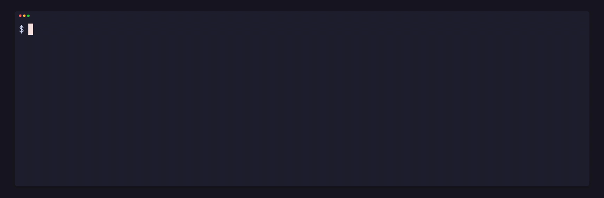

Every job runs in its own cgroup with a memory ceiling, and every job has a run-time budget. Neither needs setting: each class has its own.

## Memory ceilings

The ceiling is 24G unless `--memory` says otherwise. The job slows as it nears it (at 15/16 of it), gets no swap, and past it the kernel kills the whole job, its children included. `pgpu run` prints why and exits 137:

```sh
pgpu run --as sim --memory 64M -- ./hungry.sh; echo $?
```

```
pgpu: stopped sim (interactive): out of memory at its 64M ceiling, peak 64M; a bigger job passes --memory
137
```

Give a job that needs more a bigger ceiling, such as `--memory 48G`.

## Run-time budgets

| Class | Budget |
| --- | --- |
| `interactive` | 5 min |
| `test` | 10 min |
| `clip`, `render` | 25 min |
| `bench` | 20 min |
| `truth`, `search` | 1 h |

`--budget` sets another (`90s`, `15m`, `1h30m`). Only run time counts: time spent waiting for a lane, or frozen at a turn, never does.

Past its budget, a job keeps running, says so once on stderr, and shows red in `pgpu status`. At twice its budget pgpu stops it (SIGTERM, then SIGKILL 15 s later), and `pgpu run` exits 124:

```sh
pgpu run --as sim --budget 2s -- ./forever.sh &
pgpu status
wait $!; echo $?
```

```
pgpu: sim (interactive) passed its 2s budget; it is stopped at twice that
running  sim  ./forever.sh  · over its budget by 0.0s (budget 2s)
gpu      7% busy
pgpu: stopped sim (interactive): ran 4s, twice its 2s budget; a longer job passes --budget
124
```

## Stalls

A job that holds a lane for 5 minutes of run time with no GPU work, no `pgpu turn` and under 5 % of a CPU is stuck, and pgpu stops it the same way, exit 124. A job counts its children too, even those that moved to a cgroup of their own (such as with `systemd-run --scope`), as long as their parent chain leads back to it.

## After the fact

`pgpu stats` lists every job pgpu stopped in the last days, and why:

```
stopped  2026-10-14 21:03  sim  interactive  out of memory at 64M after 6.0s (budget 5m00s)  ./hungry.sh
stopped  2026-10-14 21:03  sim  interactive  over twice its budget after 4.0s (budget 2.0s)  ./forever.sh
```

See [see how the card was shared](../stats/).
