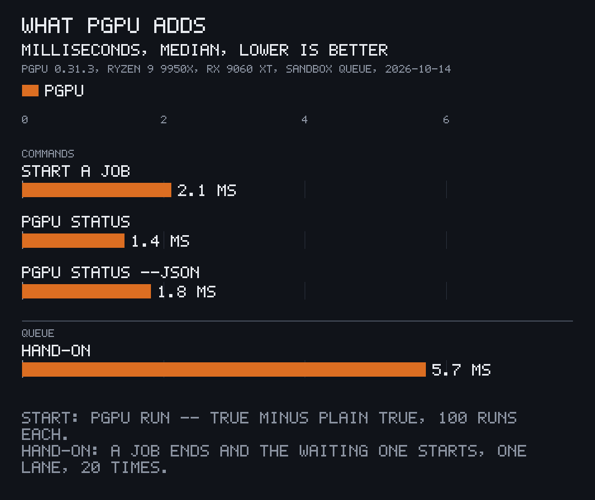

pgpu is one binary and no daemon. Every `pgpu` call does its share of the work, and the queue is a folder of small files in `$XDG_RUNTIME_DIR/pito-gpu-queue/`.

## A job's life

1. **Ticket.** `pgpu run` writes a ticket for its job (class, session, command, arrival) and stays as the job's wrapper. A waiting wrapper takes about 3.5 MB of memory.
2. **Lane.** Each waiting wrapper reads the tickets and the lanes. The first job in line takes a free lane: by class, then the session served longest ago, then the job, then arrival. A waiter that doesn't take its lane within 3 s is passed over.
3. **Cell.** The job starts in a cgroup of its own (its cell), with its memory ceiling, no swap, and `AMD_PRIORITY=-512` unless `PRIORITY=normal`. Where no cgroup can be made, it starts without a ceiling and is paused with SIGSTOP instead of the cgroup freezer.
4. **Watch.** While the job runs, its wrapper watches its run time against the budget, its GPU use (from DRM fdinfo, counting every process of the job, inside its cell or not) and its CPU, for the stall rule.
5. **Turn.** A `pgpu turn` from inside the job reaches the wrapper; when a job waits that comes first, the wrapper freezes the job's cell, hands the lane on, and thaws the job when its turn comes back.
6. **End.** When the command ends, the wrapper kills anything left in its cell, logs the hold to `log.tsv`, frees the lane and wakes the next waiter, and exits with the job's code.

A wrapper that dies (SIGKILL, a crash) never wedges the queue: every `pgpu` call, `pgpu status` included, runs a rescue pass that frees a dead wrapper's lane and kills its job.

## What it reads

| Source | For |
| --- | --- |
| amdgpu's `gpu_busy_percent` and VRAM files in sysfs | the card's load in `pgpu status` |
| DRM fdinfo under `/proc` | each job's own GPU use, for the stall rule |
| cgroup v2 (`memory.max`, `cgroup.freeze`, `cgroup.kill`, `cpu.stat`) | ceilings, turns, stops, CPU time |
| `/proc/<pid>/task/*/children` | a job's processes outside its cell |

## Speed

| What | Number | How it was measured |
| --- | --- | --- |
| Start a job | 2.1 ms median, 8.8 ms p90 | `pgpu run -- true` (2.92 ms) minus plain `true` (0.81 ms), 100 runs each, empty two-lane sandbox queue |
| Hand a lane on | 5.7 ms median, 13.4 ms p90, 25.5 ms max | one lane, a holder ends and a waiting job starts; time from the holder's last line to the waiter's first, 20 hand-ons |
| `pgpu status` | 1.4 ms median (`--json` 1.8 ms) | 100 calls each, process start included |
| A waiting job's wrapper | 3.5 MB resident | `VmRSS` of 5 waiting wrappers |
| Binary | 2.0 MB, 770 KB release download | v0.31.3 release build and its `linux-x86_64.tar.gz` |
| Clean release build | 11.2 s | `cargo build --release --locked` with an empty target folder, Rust 1.97.1 |
| Code | 10,482 lines, 5 direct dependencies, 19 crates in all | `wc -l src/*.rs`, `cargo tree` |

All measured on 2026-10-14 with pgpu 0.31.3 on a Ryzen 9 9950X and a Radeon RX 9060 XT, once, while the machine's own GPU queue was busy with real jobs. The chart is drawn by [pito-compare](https://docs.pitomd.com/pito-compare/).
