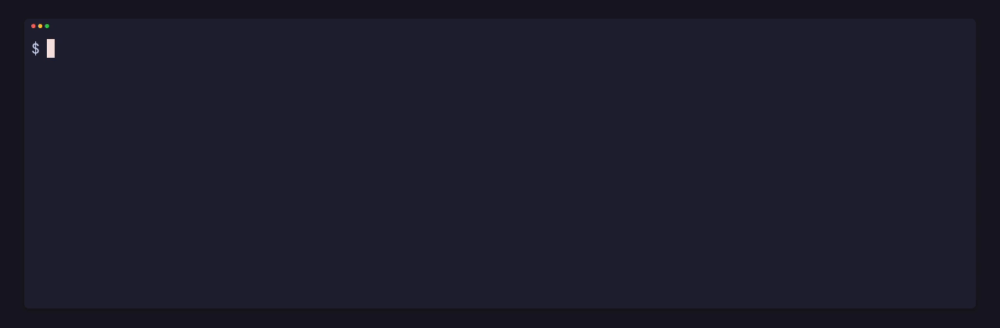

`pgpu status --json`, `pgpu stats --json` and `pgpu stats --pace --json` are a stable contract: fields are only ever added, never renamed, retyped or removed. Their spec is [the JSON formats](../../reference/formats/). Programs read these commands, never pgpu's own files.

## The card

```sh
pgpu status --json | jq -c '{gpu_busy, vram}'
```

```
{"gpu_busy":15,"vram":{"used_mib":5699,"total_mib":16304}}
```

## The jobs

```sh
pgpu status --json | jq -c '.jobs[] | {as, class, state, why}'
```

```
{"as":"blender","class":"render","state":"running","why":null}
{"as":"ci","class":"test","state":"running","why":null}
{"as":"bench","class":"bench","state":"waiting","why":"all 2 GPU lanes busy: waits its turn"}
{"as":"search","class":"search","state":"waiting","why":"all 2 GPU lanes busy: waits its turn"}
```

Each job also carries its wrapper's `pid`, `waits_for` (a short code: `turn`, `paused`, `stopped`), `budget_ms`, `ran_ms`, `over_ms` and `frozen_ms`. A job a script started is the one whose `pid` matches the `pgpu run` it launched.

Polling is cheap: a call takes about 1.8 ms with process start, and nothing in pgpu depends on how often a reader calls.

## The history

```sh
pgpu stats --json | jq -c '.killed[] | {as, why, ran_ms}'
```

```
{"as":"sim","why":"memory","ran_ms":6039}
{"as":"sim","why":"budget","ran_ms":4026}
```

`days` holds each day's use, `killed` the jobs pgpu stopped, and `benches` how many jobs ran beside each bench.

## Exit codes

A script that runs a job can tell what happened from `pgpu run`'s exit code alone: the job's own code, 124 when pgpu stopped it past twice its budget or stalled, 137 when the kernel killed it at its memory ceiling, 128 plus the signal when a signal ended it. See [run a job](../run-a-job/#exit-codes).

## Correct a job's own timings

A job that measures itself (a benchmark, a frame timer) reads wrong numbers if it was frozen at a turn or waited for the card mid-run. The file named by `GPU_QUEUE_FROZEN` holds the milliseconds it has spent frozen or waiting so far; subtract it from a wall-clock span:

```sh
start=$(date +%s%3N); before=$(cat "$GPU_QUEUE_FROZEN")
run-the-benchmark
end=$(date +%s%3N); after=$(cat "$GPU_QUEUE_FROZEN")
echo "ran $(( end - start - (after - before) )) ms"
```

When a job that was frozen or waited a second or more ends, `pgpu run` also says so on stderr, since its own wall-clock numbers are skewed.
